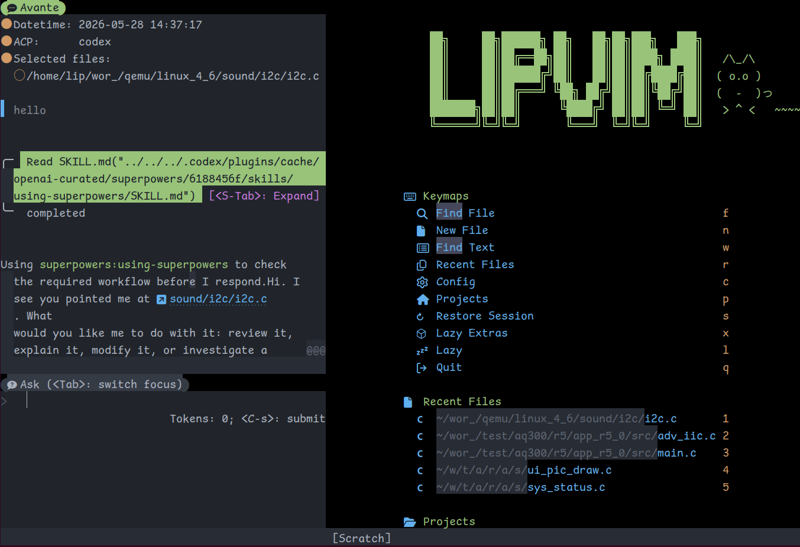
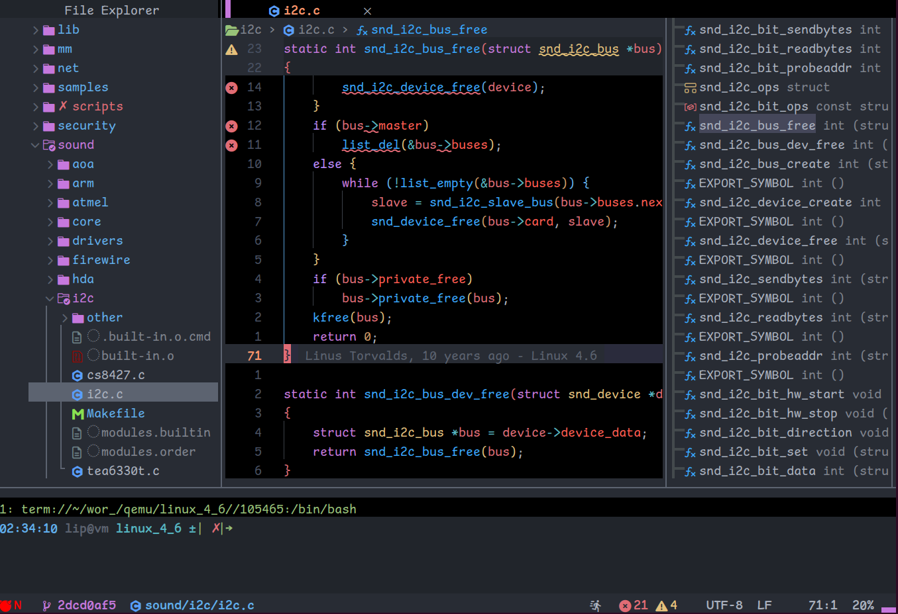
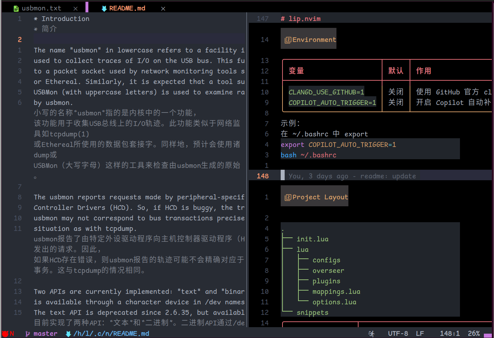

# lip.nvim

一个嵌入式工程师使用的个人 Neovim 配置，主要面向 C/C++、Python、Shell
和日常工程编辑。

这个配置不是最小化模板，而是把嵌入式开发中常用的编辑动作、工程跳转、
搜索替换、LSP、AI 辅助、Markdown 写作、多光标和构建任务整理成一套
开箱即用的工作环境，并默认以 Gitee 镜像作为主要插件更新源。
## ✨ Features

<table>
<tr>
<td valign="top" width="33%">

### 🤖 AI & Assistance

-  [Avante](https://github.com/yetone/avante.nvim) - 侧边栏式 AI 编程辅助
-  [GitHub Copilot](https://github.com/features/copilot) - AI pair programmer
-  [Copilot NES](https://github.com/copilotlsp-nvim/copilot-lsp) - Next Edit Suggestions

</td>
<td valign="top" width="33%">

### 🎨 UI & Experience

-  [onedarkpro.nvim](https://github.com/olimorris/onedarkpro.nvim) - theme
-  Custom [heirline.nvim](https://github.com/rebelot/heirline.nvim) - statusline
-  [bufferline.nvim](https://github.com/akinsho/bufferline.nvim) - 顶部 buffer 标签
-  [noice.nvim](https://github.com/folke/noice.nvim) - 命令行、消息、LSP 浮窗 UI
-  [nvim-notify](https://github.com/rcarriga/nvim-notify) - notification UI
-  [todo-comments](https://github.com/folke/todo-comments.nvim) - TODO highlighting
-  [which-key](https://github.com/folke/which-key.nvim) - keybinding helper

</td>
<td valign="top" width="33%">

### 💻 C/C++, Lua & Markdown Development

-  C/C++, Lua, Markdown and daily engineering editing
-  [blink.cmp](https://github.com/Saghen/blink.cmp) - completion engine
-  [LuaSnip](https://github.com/L3MON4D3/LuaSnip) - snippet engine
-  [nvim-treesitter](https://github.com/nvim-treesitter/nvim-treesitter) - 语法高亮、文本对象和移动
-  [nvim-treesitter-context](https://github.com/nvim-treesitter/nvim-treesitter-context) - 顶部显示当前函数/作用域上下文
-  [render-markdown.nvim](https://github.com/MeanderingProgrammer/render-markdown.nvim) - Markdown 渲染增强
-  [vim-table-mode](https://github.com/dhruvasagar/vim-table-mode) - Markdown 表格自动格式化

</td>
</tr>
<tr>
<td valign="top" width="33%">

### 🛠️ DevOps & Tools

-  [Snacks.nvim](https://github.com/folke/snacks.nvim) - files, buffers, grep, notifications, scratch, terminal, Lazygit, explorer 文件树（snacks.explorer 侧栏）
-  [telescope.nvim](https://github.com/nvim-telescope/telescope.nvim) - 补充 picker 和 yank history 集成
-  [flash.nvim](https://github.com/folke/flash.nvim) - 屏幕内快速跳转
-  [project.nvim](https://github.com/ahmedkhalf/project.nvim) - 工程根目录识别和切换
-  [harpoon](https://github.com/ThePrimeagen/harpoon) - quick file navigation
-  [navimark.nvim](https://github.com/ZWindLOR/navimark.nvim) - 持久化 bookmark
-  [mini.files](https://github.com/echasnovski/mini.files) - lightweight file manager
-  [vim-visual-multi](https://github.com/mg979/vim-visual-multi) - multi-cursor editing

</td>
<td valign="top" width="33%">

### 🧹 Code Quality

-  [mason.nvim](https://github.com/williamboman/mason.nvim) - Native LSP
-  [mason-lspconfig.nvim](https://github.com/williamboman/mason-lspconfig.nvim) - Mason and lspconfig integration
-  [nvim-lspconfig](https://github.com/neovim/nvim-lspconfig) - native LSP client configuration
-  [lspsaga.nvim](https://github.com/nvimdev/lspsaga.nvim) - LSP 浮窗、签名、上下文 UI
-  [grug-far](https://github.com/MagicDuck/grug-far.nvim) - search & replace
-  [vim-illuminate](https://github.com/RRethy/vim-illuminate) - 当前符号引用高亮
-  [neogen](https://github.com/danymat/neogen) - Doxygen 风格注释生成
-  [ts-comments.nvim](https://github.com/folke/ts-comments.nvim) - Treesitter-aware comments
-  [Lazygit](https://github.com/jesseduffield/lazygit) terminal UI
-  [gitsigns](https://github.com/lewis6991/gitsigns.nvim) - 行级变更标记和 hunk 跳转

</td>
<td valign="top" width="33%">

### ✏️ Editing Features

-  [rainbow-delimiters.nvim](https://github.com/HiPhish/rainbow-delimiters.nvim) - 彩色括号层级
-  [mini.ai](https://github.com/echasnovski/mini.ai) - 扩展 text object
-  [mini.align](https://github.com/echasnovski/mini.align) - 对齐文本块
-  [mini.surround](https://github.com/echasnovski/mini.surround) - Surround 操作
-  [mini.move](https://github.com/echasnovski/mini.move) - 移动 visual 选区
-  [mini.operators](https://github.com/echasnovski/mini.operators) - 自定义 operator，包含表达式计算
-  [nvim-autopairs](https://github.com/windwp/nvim-autopairs) - 自动补全括号和引号
-  [nvim-toggler](https://github.com/nguyenvukhang/nvim-toggler) - `true/false`、`on/off` 等词义切换
-  [yanky.nvim](https://github.com/gbprod/yanky.nvim) - Yank 历史、智能粘贴和寄存器管理
-  [overseer.nvim](https://github.com/stevearc/overseer.nvim) - Build, run, make task templates
-  [persisted.nvim](https://github.com/olimorris/persisted.nvim) - 工作区 session 保存和恢复

</td>
</tr>
</table>

## Screenshots







## Requirements

<details>
<summary>展开内容</summary>

- Neovim `0.11+`
- `git`
- `ripgrep`
- `fd`
- `make`
- `gcc` / `clang`
- `node` / `npm`
- `python3`
- Nerd Font

终端已配置 Nerd Font 时，可设置环境变量以启用 Nerd Font 图标：

```bash
export NVIM_USE_NERD_FONT=1
```

可将该设置写入 `~/.bashrc`、`~/.zshrc` 等 shell 配置文件。

部分插件或语言工具可能还需要 `cargo`、`sqlite3`、`libsqlite3-dev`、`unzip`、`curl`。
进入 Neovim 后可用 `:checkhealth` 检查缺失项。

</details>

## Installation

<details>
<summary>展开内容</summary>

备份原配置后克隆到 `~/.config/nvim`：

```bash
mv ~/.config/nvim ~/.config/nvim.bak
git clone https://github.com/qqliyunpeng/lip_nvim.git ~/.config/nvim
nvim
```

首次启动会自动 bootstrap `lazy.nvim`，并从配置中的镜像源拉取插件。

如果当前网络环境不能直接访问 GitHub，配置默认倾向使用 Gitee 镜像源。
`clangd` 也默认走自定义下载逻辑。

</details>

## Environment

<details>
<summary>展开内容</summary>

| 变量 | 默认 | 作用 |
|------|------|------|
| `CLANGD_USE_GITHUB=1` | 关闭 | 使用 GitHub 官方 clangd 下载源 |
| `COPILOT_AUTO_TRIGGER=1` | 关闭 | 启动 Copilot（含语言服务器与自动补全），运行时可用 `<leader>uc` 切换 |
| `COPILOT_MAX_HEAP_MB` | `1024` | copilot-language-server 的 V8 堆上限（MB）。语言服务器常驻约 700-800MB，只在 lua/python/markdown 下启动；设太小会 OOM（实测 512 启动即崩） |

示例：
在 ~/.bashrc 中 export
```bash
export COPILOT_AUTO_TRIGGER=1
bash ~/.bashrc
```


</details>

## Project Layout

<details>
<summary>展开内容</summary>

```text
.
├── init.lua
├── lua
│   ├── configs
│   ├── overseer
│   ├── plugins
│   ├── mappings.lua
│   └── options.lua
└── snippets
```

| 路径 | 说明 |
|------|------|
| `init.lua` | 入口、leader、lazy bootstrap、全局高亮和命令 |
| `lua/mappings.lua` | 全局快捷键 |
| `lua/options.lua` | Neovim 基础选项 |
| `lua/plugins/` | 插件声明 |
| `lua/configs/` | 插件配置和本地工具函数 |
| `lua/overseer/` | 任务模板 |
| `snippets/` | LuaSnip 片段 |

</details>

## Quick Start

<details>
<summary>展开内容</summary>

### C/C++ LSP

`clangd` 需要项目里有 `compile_commands.json`，否则代码理解会明显下降。

Makefile 项目可用：

```bash
compiledb make
```

CMake 项目可用：

```bash
cmake -DCMAKE_EXPORT_COMPILE_COMMANDS=ON ..
```

### Root Detection

使用 `:Root` 切到当前工程根目录。根目录标记包括：

```text
.git
_darcs
.hg
.bzr
.svn
Makefile
package.json
```

### Generate Comments

```vim
:Neogen
```

### Window Placement

把当前窗口移动到指定方向：

```vim
<c-w> H
<c-w> J
<c-w> K
<c-w> L
```

### 侧边栏布局（edgy.nvim）

`edgy.nvim` 把侧边栏 / 面板窗口固定到左右上下四条 edgebar：插件打开窗口时自动归位，不再把主编辑区拆得七零八落。

它只接管 `lua/configs/edgy.lua` 里登记过的 filetype（白名单），其余窗口（snacks picker、lazygit 终端、noice、AI 浮窗）行为完全不变：

| 位置 | 接管的窗口 | 尺寸 |
|---|---|---|
| left | Explorer（snacks.explorer，`<F2>`）+ Avante：`Avante`（结果区，自适应）/ `AvanteSelectedCode` 25% / `AvanteSelectedFiles` 15% / `AvanteTodos` 8% / `AvanteInput` 20% | Avante 打开时 40% 屏宽（`M.avante_width`）；只有 Explorer 时 30 列（`M.explorer_width`，最多 40% 屏宽）。两者**共用一个左侧 edgebar**，所以同时打开时 Explorer 也是 40% 宽 |
| bottom | `OverseerList` / `OverseerForm` / `OverseerTaskAction`（`<leader>ow`、`<leader>oo`） | 30% 行高 |
| bottom | `qf`（`:copen`，或 overseer 任务失败自动填充的 quickfix） | 同上，和 Overseer 共用底部 edgebar |
| bottom | `snacks_terminal`（`<A-b>`） | 同上 |

底部 edgebar 同时有好几个窗口时会**左右并排**（这是 edgy 自己的布局规则，不按高度分）。

#### Avante 侧栏交给 edgebar 后

宽度只在 `configs/edgy.lua` 里定义：Avante 打开时 `M.avante_width = 0.4`，只有 Explorer 时 `M.explorer_width = 30` 列；avante 的 `windows.width` 由前者推算，窗口的实际宽高由左 edgebar 分配，同时打开 Explorer 时两者上下堆在同一列（所以两边的宽度一定相等）。

但这层接管没有做额外 patch，而 avante 上游仍会在每次渲染 / 窗口变化时自己调 `nvim_win_set_width/height`（`adjust_*_layout`、`resize`、`toggle_code_window`），两套分配抢同一个窗口，已知会出现：

| 现象 | 原因 / 补救 |
|---|---|
| 打开侧栏后底部多出一大块空白 | 容器窗口是 nui Split（默认 `winfixheight = true`），被搬进 edgebar 的瞬间 Neovim 无法把多余的行分给窗口，于是整块塞进 `'cmdheight'`。`configs/ai.lua` 在 Avante render 期间暂停 edgy layout，并在结束后恢复 `cmdheight`，已自动处理 |
| 宽度偶尔抖动 / 被压扁 | avante 的 `resize`（`VimResized` 触发）和 edgebar 的 `size` 抢同一个窗口宽度 |
| `<leader>az`（zen）退出后主窗口变成 0 宽 | 上游 zen 直接 `nvim_win_set_width(code.winid, 0)`、结果区设成 `columns - 1`，退出时恢复不回来。补救：`<c-w>=` |
| edgebar 标题栏被清掉 | avante 建窗时会写 `winbar = ""`，需要等窗口挂稳后手动盖回去 |

不想让 edgy 管 Avante 就把 `M.avante` 改回 `false`，`right` 里的 view 列表整个不注册，Avante 回到自己管布局。

edgebar 窗口内的按键（edgy 默认）：

| 按键 | 作用 |
|---|---|
| `q` | 关闭当前 edgebar 窗口 |
| `<c-q>` | 隐藏当前 edgebar 窗口 |
| `Q` | 关闭整条 edgebar |
| `]w` / `[w` | 下一个 / 上一个可见 edgebar 窗口 |
| `<c-w>>` / `<c-w><` | 加宽 / 收窄 edgebar |
| `<c-w>+` / `<c-w>-` | 加高 / 压低 edgebar |
| `<c-w>=` | 恢复默认尺寸 |

注意：

- edgebar 整体折叠依赖全局状态栏（`heirline` 里已经 `set laststatus=3`）。
- `splitkeep=screen` 在 edgy 的 `init` 里设置，否则打开侧栏时主窗口内容会跟着跳。
- 想临时让某个窗口不被接管：`:lua vim.b[buf].edgy_disable = true`（也可以提前写进对应 filetype 的 autocmd）。
- `overseer` 的三个窗口和 `AvanteSelectedCode` 已加进 `configs/ui_all.lua` 中 `windows.nvim` 的 `ignore.filetype`（explorer 侧栏本来就在），避免 autowidth 和 edgebar 抢宽度。

### Clear Swap Files

```bash
rm ~/.local/state/nvim/swap/*
```

</details>

## Keybindings

<details>
<summary>展开内容</summary>

`,` 是 leader key。

按 `<leader>?` 可以打开 which-key，查看当前 buffer 可用快捷键。

### General

| Key | Mode | Action |
|-----|------|--------|
| `Space` | n | 进入命令行 |
| `jk` / `kj` | i | 退出插入模式 |
| `<leader>q` | n | 关闭当前窗口 |
| `<leader>x` | n | 退出所有窗口 |
| `<C-s>` | n/i | 保存当前文件 |
| `<Esc>` | n | 清除搜索高亮 |
| `<A-q>` | n/x/c | 退出当前交互或清除高亮 |

### Movement & Windows

| Key                | Mode  | Action                              |
|--------------------|-------|-------------------------------------|
| `<C-h/j/k/l>`      | t     | 从终端切到相邻窗口                  |
| `H`                | n/x/o | 跳到行首非空字符                    |
| `L`                | n/x/o | 跳到行尾非空字符                    |
| `J` / `K`          | n/x/o | 向下/向上移动 5 行                  |
| `<C-h/j/k/l>`      | n     | 在窗口间移动                        |
| `<C-h/j/k/l>`      | i     | 插入模式移动光标                    |
| `<BS>`             | n     | SSH 终端里替代 `<C-h>` 切到左侧窗口 |
| `<C-S-Up/Down>`    | n     | 调整水平分屏高度                    |
| `<C-S-Left/Right>` | n     | 调整垂直分屏宽度                    |

### Files, Buffers & Pickers

| Key | Mode | Action |
|-----|------|--------|
| `<leader>p` | n | 查找文件 |
| `<leader>r` | n | 最近文件 |
| `<leader>ff` | n | 查找文件 |
| `<leader>fa` | n | 查找隐藏和 ignored 文件 |
| `<leader><Tab>` | n | buffer 列表 |
| `<leader>fw` | n | live grep |
| `<leader>fc` | n/x | 搜索当前词或视觉选择内容 |
| `<leader>fl` | n | 当前 buffer 行搜索 |
| `<leader>fz` | n | 当前 buffer 内 fuzzy find |
| `<leader>fu` | n | undo 历史 |
| `<leader>fh` | n | help tags |
| `<leader>fM` | n | man pages |
| `[b` / `]b` | n | 上一个/下一个 buffer |
| <code>&lt;leader&gt;`</code> / <code>&lt;A-`&gt;</code> | n | 切回上一个 buffer |
| `<leader>bd` | n | 删除当前 buffer |
| `<leader>bo` | n | 删除其它 buffer |
| `<F2>` | n | 打开/关闭 snacks explorer |

### Search & Replace

| Key | Mode | Action |
|-----|------|--------|
| `<A-/>` | n/x | 搜索当前词或视觉选择内容 |
| `<leader>fc` | n/x | picker 搜索当前词或视觉选择内容 |
| `<leader>fw` | n/x | picker 搜索 |
| `<leader>sr` | n/v | 打开 grug-far 查找替换 |
| `m` | n/x/o | Flash jump |
| `gl` | n/x/o | Flash 行首跳转 |
| `]]` / `[[` | n/t | 下一个/上一个引用 |


#### Snacks picker 搜索参数

picker 后端统一在 `init.lua` 中选择：

```lua
-- 可选：'fzf-lua' 或 'snacks'
vim.g.picker_backend = 'snacks'
```

- 在输入框中按 `<C-g>`，切换到 fuzzy grep 搜索方式。
- 按 `<A-w>`，在 picker 的输入框、列表和预览窗口之间切换焦点。

`<leader>fw`、`<leader>fc` 这类 snacks grep picker 的输入框支持直接追加 ripgrep 参数：`--` 之前是搜索模式，`--` 之后原样传给 `rg`。

```text
malloc -- -i -g *.c -g *.h
```

| 参数 | 含义 | 示例 |
|------|------|------|
| `-i` | 忽略大小写 | `foo -- -i` |
| `-s` | 区分大小写 | `Foo -- -s` |
| `-F` | 按字面量匹配，不当正则 | `a.b -- -F` |
| `-w` | 全词匹配 | `init -- -w` |
| `-g *.c` | 只搜匹配的文件 | `-g *.c -g *.h` |
| `-g !*.o` | 排除匹配的文件 | `-g !*.o` |
| `-t cpp` | 按 rg 文件类型搜索 | `-t cpp` |
| `-T python` | 排除文件类型 | `-T python` |
| `-U` | 跨行匹配 | `-- -U` |
| `--hidden` | 包含隐藏文件 | `-- --hidden` |
| `--no-ignore` | 包含被 ignore 的文件 | `-- --no-ignore` |

注意：

- `<leader>fw`、`<leader>fc` 默认按字面量搜索（`lua/configs/snacks.lua` 中 `sources.grep` / `sources.grep_word` 的 `regex = false`，等价于 `rg --fixed-strings`）：空格和 `.`、`(` 等字符都不再当正则，输入框首尾空格也会保留参与匹配。需要正则时在 picker 里按 `<a-r>` 切到 regex 模式。
- `<leader>fw`、`<leader>fc` 的标题栏会显示参数提示（`lua/configs/snacks.lua` 的 `grep_hint`）：`--` 之后是 rg 参数，`-s` 区分大小写、`-w` 全词匹配。
- 默认忽略大小写：grep 走 `rg --smart-case`，即搜索词全为小写时忽略大小写，一旦出现大写字母就区分大小写；需要始终忽略大小写时在输入框加 `-i`。
- files 等文件 picker 的 matcher 同样是 `smartcase` + `ignorecase`，行为与上面一致。
- `--` 前后都要有空格。
- 参数不要加引号：`-g '*.c'` 会把引号当成 glob 的一部分而匹配不到，写 `-g *.c`。
- 只对 grep 类 picker 生效（`<leader>fw`、`<leader>fc`），`<leader>ff` 等文件 picker 不支持。
- 常用参数也可以固化到配置里：`lua/configs/picker.lua` 的 `grep_word({ ... })`，或 `lua/configs/snacks.lua` 中 `sources.grep` / `sources.grep_word` 的 `args`、`glob`、`ft`、`hidden` 等字段。
- 带 `--` 的输入会进入 picker 历史，可重复调用。

### LSP

| Key | Mode | Action |
|-----|------|--------|
| `gd` | n | 跳到定义 |
| `gD` | n | 跳到声明 |
| `gr` | n | 查找引用 |
| `gf` | n | 当前关键字定义或引用列表 |
| `<leader>sh` | n | signature help |
| `<A-f>` | i | 插入模式查看函数参数 |
| `<leader>wa` | n | 添加 workspace folder |
| `<leader>wr` | n | 移除 workspace folder |
| `<leader>wl` | n | 列出 workspace folders |
| `<leader>ca` | n/v | code action |

### Git

| Key | Mode | Action |
|-----|------|--------|
| `<leader>gg` | n | Lazygit |
| `<leader>gt` | n | Git status |
| `<leader>gc` | n | Git commits |
| `<leader>gb` | n | 当前行 blame |
| `<leader>gl` | n | 当前文件 Git log |
| `<leader>gL` | n | Git log |
| `]g` | n | 下一个 git change |
| `[g` | n | 上一个 git change |

### Harpoon & Marks

| Key | Mode | Action |
|-----|------|--------|
| `<leader>ha` | n | 当前文件加入 Harpoon |
| `<leader>fe` | n | 打开 Harpoon 菜单 |
| `<A-1>` 到 `<A-5>` | n | 跳到 Harpoon 第 1 到第 5 个文件 |
| `<C-S-P>` / `<C-S-N>` | n | Harpoon 上一个/下一个 |
| `<leader>mc` | n | 删除 bookmark |
| `<leader>fm` | n | 打开 bookmark picker |

### Clipboard & Paste

| Key | Mode | Action |
|-----|------|--------|
| `p` / `P` | n | 智能粘贴 |
| `p` / `P` | x | 替换选择区但不污染默认寄存器 |
| `"0p` | n | 粘贴 yank 的内容，不受 delete 影响 |
| `<leader>y` | n | 打开 yank 历史 picker |
| `<C-x>` | yank picker insert | 删除一条 yank 记录 |
| `<C-r>` | yank picker insert | 设置当前 yank 到默认寄存器 |

普通模式下 `c`、`d`、`x` 默认不复制到剪贴板，避免删除动作覆盖 yank 内容。

#### 删除/修改类按键与剪贴板（规则）

`clipboard=unnamedplus` 下，任何写默认寄存器（`"`）的操作都会同步写系统剪贴板，因此改变/删除类按键统一用黑洞寄存器 `"_` 包了一层（见 `lua/mappings.lua`）：

| 模式 | 不写剪贴板（走 `"_`） | 写入剪贴板 |
|------|------|------|
| normal | `c` `C` `d` `D` `x` `X` `s` `S` | `y`（以及 `"0p` 这类显式指定寄存器的操作） |
| visual | `x` `c` | `s` `d` |

visual 下 `X` 未做映射，保持内置语义（整行删除并写寄存器）。
SSH 会话走 OSC 52（`vim.ui.clipboard.osc52`）时规则完全一致。

#### 删除/修改类按键与剪贴板（实测）

测试

| 操作 | 写剪贴板 | 默认寄存器 |
|------|---------|-----------|
| n `ciw` / `cw` / `cc` / `diw` / `dw` / `dd` | 否 | 不变 |
| n `x` / `X` / `s` / `S` | 否 | 不变 |
| n `yiw` / `yw` / `yy` | 是 | 被 yank 文本 |
| v `x`（`viwx`） | 否 | 不变 |
| v `c`（`viwc`） | 否 | 不变 |
| v `s`（`viws`） | 是 | 选中的文本 |
| v `d`（`viwd`） | 是 | 选中的文本 |
| `ciq`（vim-textobj-quotes） / `cif`（treesitter textobject） | 否 | 不变 |


### Text Objects

| Key           | Mode  | Action                  |
|---------------|-------|-------------------------|
| `vaq` / `viq` | n/o/x | 选择引号内容            |
| `vaj` / `vij` | n/o/x | 选择 `{[(` 等括号内容   |
| `var` / `vir` | n/o/x | 选择同缩进段落          |
| `vau` / `viu` | n/o/x | 选择到 `, . : ; ! ?`    |
| `vac` / `vic` | n/o/x | 选择 光标后边的 commits |
| `vai` / `vii` | n/o/x | 选择光标后的缩进块(indent-blankline)      |

### Comments

| Key | Mode | Action |
|-----|------|--------|
| `<leader>cc` | n/v | 切换注释 |
| `gco` | n | 在下方新增注释行 |
| `gcO` | n | 在上方新增注释行 |

### Terminal & Scratch

| Key | Mode | Action |
|-----|------|--------|
| `<A-b>` | n | 打开终端 |
| `<A-b>` | t | 隐藏终端 |
| `<leader>.` | n | 打开 scratch |
| `<leader>S` | n | 选择 scratch |

### Markdown & Todo

| Key | Mode | Action |
|-----|------|--------|
| `<leader>ut` | n | 开关 table mode |
| `<leader>tr` | n | Markdown 表格整理 |
| `<leader>fo` | n | 查找 TODO/NOTE/FIX/FIXME |
| `]t` / `[t` | n | 下一个/上一个 TODO/NOTE/FIX/FIXME |

### Toggles

| Key          | Mode | Action                      |
|--------------|------|-----------------------------|
| `<leader>ui` | n/v  | `True <-> False` 等词义切换 |
| `<leader>ua` | n    | 开关 autopairs              |
| `<leader>un` | n    | 关闭所有通知                |
| `<leader>us` | n    | 开关 spell                  |
| `<leader>uw` | n    | 开关 wrap                   |
| `<leader>uL` | n    | 开关 relativenumber         |
| `<leader>ud` | n    | 开关 diagnostics            |
| `<leader>ul` | n    | 开关 line number            |
| `<leader>uh` | n    | 开关 inlay hints            |

### Visual Multi

#### Basic Keys

| Key |jAction |
|-----|--------|
| `<C-n>` | 选择当前词，并继续选择下一个相同词 |
| `<C-Up>` / `<C-Down>` | 在上/下方创建光标 |
| `\\\` | 创建多光标后用方向键移动 |
| `<C-j>` / `<C-k>` | 在 `\\\` 后向下/向上扩展光标 |
| `<C-c>` / `<A-q>` | 退出 VM mode |

#### Pattern

- `\\w` 切换 whole word search。
- `\\c` 在 case sensitive、ignorecase、smartcase 间切换。

#### Select In Scope

1. 视觉模式选中内容。
2. 按 `<C-n>` 进入 multi mode。
3. 使用 `mii`、`mai`、`maq`、`maj` 等选择范围。
4. `8mj` 表示向下 8 行内查找相同选择。
5. 如果没有提前选择内容，先用 `\\\` 或 `<C-Down>` 创建选择，再用 `sii`、`sai`、`saq`、`saj`。

#### Work With `<C-n>`

1. `<C-n>` 选择当前光标所在词。
2. `<C-n>` / `n` / `N` 跳到下一个或上一个相同词。
3. `q` 取消当前跳转到的选择。
4. 重复选择和取消。
5. 用 `<A-[>` / `<A-]>` 在已选择项之间移动。

#### Align

1. 用 `<C-Down>` 创建多个光标。
2. 用 `w` / `e` 向后移动到需要对齐的位置。
3. `\\a` 对齐。

#### Numbering

1. 用 `<C-Down>` 创建多个光标。
2. `\\N` 打开编号窗口：`begin number`、`step`、`same text`。
3. `\\N` 在光标前插入编号，`\\n` 在光标后追加编号。

#### Join Alternating Lines

原始内容：

```text
123
145
156
178
```

目标：

```text
123 145
156 178
```

步骤：

1. 用 `<C-Down>` 选择每行开头。
2. 用 `\\R` 隔一行选择。
3. 按 `J` 合并。

#### Increment Numbers

把多行数字：

```text
1
1
1
```

变成：

```text
1
2
3
```

选中第二、三行的 `1`，按 `g<C-a>`。`<C-a>` 是增加数字，加 `g` 表示按序递增。
对应的减少操作是 `<C-x>`。

### Mini.nvim

#### mini.files

| Key | Action |
|-----|--------|
| `L` | go_in_plus |
| `H` | go_out_plus |
| `@` | reveal_cwd |
| `<BS>` | reset |
| `<` | 将当前窗口移动到最左侧 |
| `>` | 将窗口向右移动 |

#### mini.move

只在 visual 模式下生效。

| Key | Action |
|-----|--------|
| `<A-j>` | 选中块向下移动 |
| `<A-k>` | 选中块向上移动 |
| `<A-h>` | 选中块向左移动 |
| `<A-l>` | 选中块向右移动 |

#### mini.align

选中要操作的块后：

| Key                        | Action                             |
|----------------------------|------------------------------------|
| `ga`                       | 开始对齐                           |
| `gA`                       | 带预览开始对齐                     |
| `j`                        | 进入模式后选择对齐方式，默认左对齐 |
| `,` / `=` / `\|` / `space` | 常用分隔符                         |

### Calculator

选中表达式后按 `gz=` 可直接计算。

示例：

```c
#define OPE() (0x123f + 1)
```

### 统计 Visual 选区中的元素个数

进入 Visual 模式选中一段文本后，Heirline 状态栏会显示选区中
按空白字符或逗号分隔的元素个数。空白字符包括空格、Tab 和换行等。

状态栏格式为：

- `[s:number]`：按空白字符分隔
- `[,:number]`：按逗号分隔

如果选区同时包含逗号和空白字符，则优先按逗号统计。

示例：

- `a b c  ` → 3
- `a b` → 2
- `a   b` → 2
- `a<Tab>b` → 2
- `a, b` → 2
- `a, , b` → 3

</details>

## Known Issues

- **lazy.nvim `keys` 占位映射会删掉自己定义的映射**：若插件 spec 用 `keys = { "c", "d", ... }`（纯字符串、无 rhs）来懒加载，lazy 为它们建的占位映射在插件加载完成后会被 `vim.keymap.del` 删除且不会恢复，于是把 `lua/mappings.lua` 里的 `c -> "_c` / `d -> "_d` 一起删掉。表现为“会话用一会儿之后 `ciw`/`diw` 又开始把删除内容写进剪贴板”。已把 `nvim-treesitter-textobjects`、`vim-textobj-quotes` 改成 `event = "VeryLazy"` 加载。排查办法：在会话里 `:nmap c` 看映射是否还在，或用 `debug.traceback()` 包一层 `vim.keymap.del` 抓调用栈。
- persisted session 的 workspace select UI 里，`<C-c>` 可能不会关闭窗口，而是复制 session，需要手动关闭。
- CRLF 类型的大文件打开时可能因为 treesitter 加载变慢。例如 5000 行 `.c` 文件启动可能需要数秒。
- **Avante 侧栏的宽高由 edgy edgebar 分配**（`configs/edgy.lua` 的 `M.avante = true`），但 avante 上游仍会自己 `nvim_win_set_width/height`，所以宽度会互相拉扯；已知副作用：`<leader>az` 退出 zen 后主窗口会留在 0 宽（`<c-w>=` 可解）、avante 自己建的 `winbar = ""` 会清掉 edgebar 标题栏；打开时 `cmdheight` 被撑大的问题已由 `configs/ai.lua` 的 render 包装处理。

## Notes

- README 里的快捷键只记录高频入口；完整映射以 `lua/mappings.lua` 和 `lua/plugins/` 为准。
